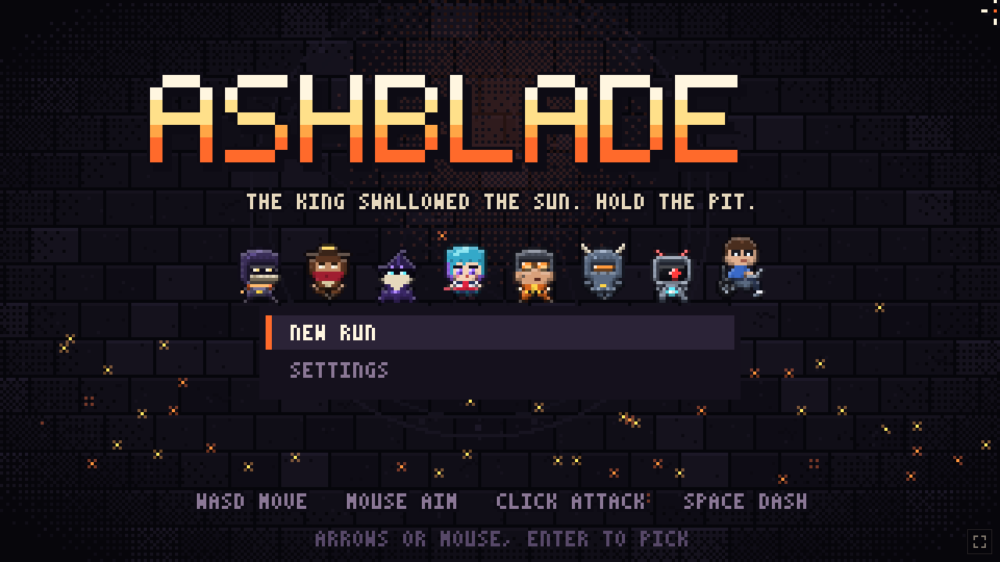
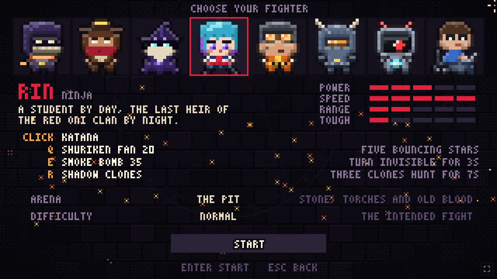
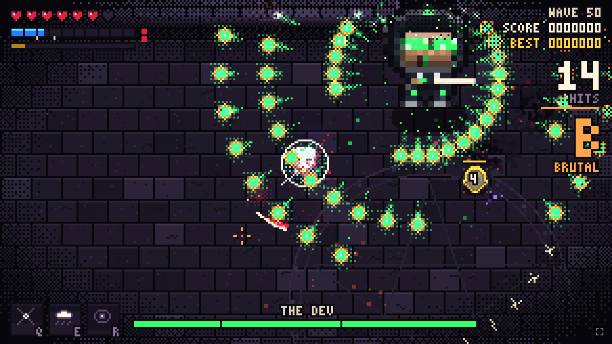
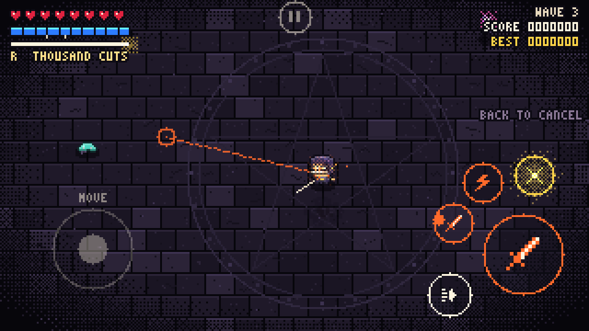

# Ashblade

Ashblade is a pixel-art hack and slash game that runs in the browser, on a computer or a phone. You pick a fighter and hold an arena against waves of enemies. Every fifth wave is a boss, and the fourth boss, the Ashen King on wave 20, ends the story. After that the game goes endless, and every wave adds 15% enemy health, more enemies and more elites.

**Play it at [ash-blade.vercel.app](https://ash-blade.vercel.app/).**

## Story

The Ashen King swallowed the sun and sealed the last of the world in a pit. Seven fighters went down after him, each for a reason of their own. An eighth was there before any of them.

## Fighters

Every fighter has a basic attack, two powers on Q and E that cost energy, and an ultimate on R that charges as your basic attack lands.

| Fighter | Hero | Basic attack | Q | E | R |
| --- | --- | --- | --- | --- | --- |
| Blade | Kael | 4-hit sword combo: slash, X-cut, thrust, whirlwind | Rift: blinks forward and cuts every enemy on the line | Tempest: knocks enemies back and chains lightning between them | Thousand Cuts: stops time and cuts every enemy on screen |
| Gunner | Vega Hale | Revolver, reloads after 14 shots | Buckshot: shotgun blast that pushes you back | Grenade | Last Stand: 4 seconds of minigun |
| Wizard | Morrow | Homing magic bolt | Frost Blink: teleports and freezes enemies at both ends | Meteor | Starfall: meteors land on enemies for about 3 seconds |
| Ninja | Rin | 4-hit katana combo: cut, X-cut, lunging stab, a quick-draw that dashes through and cuts twice. 2 dashes | Shuriken Fan: 5 stars that bounce off walls | Smoke Bomb: 3 seconds invisible, next hit does triple damage | Shadow Clones: 3 clones attack for 7 seconds |
| Mechanic | Rivet | Wrench combo: swing, twirl, ground slam | Turret, up to 2 at once | Tesla Coil: zaps 3 enemies at a time for 7 seconds | Junk Golem: a scrap giant fights for 12 seconds |
| Tank | Grom | Slow hammer combo: sweep, ground slam, full spin. 12 health | Bulldoze: charges and pins enemies against walls | Ground Slam: shockwaves that stun | Fortress: 6 seconds of no damage, shots bounce back |
| Robot | Unit-7 | Laser that overheats if you hold it too long | Rocket Salvo: 6 homing rockets | Barrier: blocks 3 hits, then bursts | Orbital Laser: a beam from above follows your aim for 4.5 seconds |

Every fighter, monster and boss breathes, blinks and leans into attacks. Every fighter also has its own attack and hit sounds: steel rings for the Blade, an anvil clang for the Mechanic, a chiptune arpeggio for The Dev, and so on. Hits rise in pitch as your combo grows. Each fighter also has its own entrance at the start of a run. The Tank falls from the sky and cracks the floor, the Robot teleports down in a beam, and the Mechanic breaks out of a crate.

The eighth fighter is The Dev, who wrote this world and is now debugging it from the inside. He starts as an ordinary programmer with a laptop on his lap, riding a motorized wheelchair. At 250% power a laser rewrites him into his hooded form, riding a rebuilt chair with neon wheels and a holo screen. He starts at full power with a two-shot spread and gets stronger every wave and every 20 kills, faster still after wave 20: about 1.8x by wave 10, 4.5x by wave 30 and close to 10x by wave 50. His shots plant bugs, and four bugs crash an enemy.

Every other fighter also awakens into a new look once per run: on its first evolution upgrade or at wave 25. A beam of light hits them, they change skin and gain 1 max health. The awakened forms are Ashen Kael, Deadeye Vega, Archmage Morrow, Oni Rin, Rivet Mk-II, Titan Grom and Unit-7 Omega.

### Unlocking fighters

You start with Blade. Every other fighter unlocks when you finish its mission, and the game tells you the moment it happens. The fighter select screen shows each mission and how close you are.

| Fighter | Mission |
| --- | --- |
| Gunner | Reach wave 10 |
| Wizard | Land a 100-hit combo |
| Ninja | Make 25 perfect dodges in one run |
| Mechanic | Kill 1500 enemies in total, across all runs |
| Tank | Beat any boss without getting hit |
| Robot | Defeat the Ashen King |
| The Dev | Reach wave 50 |

## Upgrades

After every wave you pick one of three upgrades. Each fighter has about 60 picks before the list runs out, which lasts past wave 50. Taking an upgrade to its maximum level unlocks its evolution:

| Max this | Evolution |
| --- | --- |
| Ultimate Mastery | Your ultimate becomes version II: it lasts longer or hits harder, then you deal double damage for 8 seconds |
| Spell Mastery | Q and E cast a second time for free |
| Weapon Mastery | Basic hits release homing spirits |
| Heartwood | Survive one killing blow per wave |
| Swift Step | An extra dash, and dashing cuts every enemy you pass |
| Static Charge | Every 4th hit chains lightning to 7 enemies |
| Kindling | Burning enemies explode when they die |
| Orbit Blades | Twice the blades, on a wider orbit |

## Enemies

| Enemy | From wave | What it does |
| --- | --- | --- |
| Husk | 1 | Walks up and lunges |
| Wisp | 2 | Keeps its distance and fires pink orbs |
| Tick | 3 | Runs at you and explodes |
| Slime | 3 | Hops at you and hurts when it lands. Splits into two small slimes when it dies |
| Brute | 4 | Charges in a straight line and stuns itself on walls |
| Spitter | 5 | A rooted plant that lobs acid where you are heading. The acid stays on the floor for 4 seconds |
| Shade | 8 | Fades out, reappears behind you, and slashes after a short warning |

## Bosses

| Wave | Boss | What it does |
| --- | --- | --- |
| 5 | The Warden | Sword sweeps, jumps that send out shockwaves, spirals of orbs, rings of orbs with one gap, four rotating chain beams |
| 10 | The Brood Mother | Digs under the floor and comes up under you, spits acid, lays eggs, releases swarms of larvae, rains acid over the whole arena |
| 15 | Iron Colossus | Sweeping lasers, missile strikes, a rocket fist that flies back to its arm, and four spinning lasers. Its shield breaks only when you hit it with an orb you knocked back |
| 20 | The Ashen King | Twice the size of the other bosses, with three phases. He summons armored knights, sends out rings of fire, and in the last phase darkens the arena, spins six beams around himself and uses Thousand Cuts on you |

After wave 20 six more bosses join, ending with The Dev himself on wave 50. Then all ten repeat with more health each time:

| Wave | Boss | What it does |
| --- | --- | --- |
| 25 | Void Wyrm | A serpent whose whole body hurts to touch. Tunnels under you, breathes a cone of orbs, circles you and spits inward |
| 30 | Storm Herald | Calls lightning on your position, teleports, keeps four storm orbs firing at you, and fires lightning lances |
| 35 | The Mirror | A dark copy of your own fighter. Dashes, slash combos and rift lines like yours, and brings elite husks in its second half |
| 40 | Eclipse | A giant eye. Spirals, rings and rotating beams of light, and darkens the arena in its second half |
| 45 | The Clockwork | A brass clock. Its hour and minute hands sweep the arena as beams, it freezes a ring of shots in mid-air and then turns every one toward you, fires rings in a tick-tock rhythm, and in its second half sets off twelve strikes around you like the hours on a dial |
| 50 | The Dev | The final boss: The Dev at three times the size, compiling into the arena from a terminal. Packet volleys, RM -RF lines you have to dash through, firewalls of shots with one gap, fork bombs of minions, a DDOS that sweeps the arena row by row with one safe gap, and lag-spike teleports. Sudo Mode at 60% health speeds him up, and Kernel Panic at 25% darkens the arena and spins beams while he fires a spiral |

Every boss has 50% more health than its base, acts 25% faster than the other enemies, and enrages after 60 seconds, which makes it 50% faster. The health bar counts down the last 15 seconds before the enrage.

When a boss arrives, your fighter freezes until its entrance is over: you can't move, attack or use powers, and nothing can hurt you.

Each boss has its own entrance and its own music. When a boss is off screen, an arrow on the edge of the screen points to it and shows how far away it is. The music adds reverb, a choir on the slow themes and a crowd shout on the fast ones.

## Controls

| Action | Keyboard and mouse | Phone |
| --- | --- | --- |
| Move | WASD or arrow keys | Fixed stick in the bottom-left. Touch anywhere on the left side to use it |
| Aim | Mouse | Drag from the attack button toward where you want to hit. A plain tap aims at the nearest enemy |
| Attack | Left click or J, hold to keep attacking | Big button on the right. Tap for one attack, hold to keep attacking |
| Dash | Space or right click | Dash button |
| Powers | Q, E, R | Buttons around the attack button. Tap to cast at the nearest enemy. For aimed powers, hold and drag to aim (further means farther), lift to cast, or drag back onto the button to cancel |
| Pause | Esc | Button at the top |

You can't be hit while dashing. If you dash through an attack just as it lands, time slows down, you get energy back, and your next hit within 2.5 seconds is a counter: triple damage and a shockwave that hits everything nearby.

After you take a hit you can't be hit again for 0.8 seconds. Clearing a wave doesn't heal you, so health only comes from drops and upgrades.

Use the button in the bottom-right corner, or F11, to go fullscreen. Escape pauses the game and doesn't leave fullscreen (in Firefox and Safari it still does).

Hitting a pink orb sends it back at the enemies. Orbs with a red ring can't be sent back.

On a phone, the game asks you to turn the phone sideways. It pauses whenever you turn it back upright.

## Settings

- Audio: master, music and effects volume. The soundtrack setting either follows the fight or plays one track of your choice. You can also pick which of the four battle tracks plays during normal waves. The default is HYPERDRIVE, a 150 bpm hard-kick EDM track that also plays on the title screen. The fast tracks are built like EDM: four-on-the-floor kicks, offbeat bass, chord stabs, and an 8-bar cycle that builds up with a snare roll and a riser, then drops.
- Video: resolution (sharpest whole-number zoom, fill the screen, or a fixed 720p to 1440p), color theme, vibrancy, brightness, contrast, hue shift and scanlines. You can also turn down screen shake, flashes, damage numbers and particles.
- Game: arena, difficulty, blood stains and vibration. Blood and scorch marks fade after about 10 seconds by default, or 30 seconds, or never. Vibration has four levels (off, light, medium, strong) and works on phones whose browser supports it, which includes Android but not iPhone. There are 5 arenas. On the ice everything slides, and in the forge, enemies knocked into lava catch fire.

## Saving

The game saves your run at the start of every wave. You can quit from the pause menu and pick the run up later with Continue on the title screen. Your best score is saved for each fighter.

## How it's built

The game is plain JavaScript with no libraries and no build step. It draws everything at 320×180 and scales it up. The sprites are written as grids of characters in the code, and all music and sound effects are generated in the browser with the Web Audio API, so the game has no image or audio files.

The page makes no network requests. A Content Security Policy only allows the game's own files to load. Saved settings and runs are checked against the allowed values before they are used.

| File | Contents |
| --- | --- |
| `src/main.js` | Main loop, screens, saving |
| `src/world.js` | Combat, enemies, projectiles, arena drawing |
| `src/chars.js` | The seven fighters |
| `src/bosses.js` | The four bosses |
| `src/ui.js` | HUD, menus, settings, title intro, phone controls |
| `src/maps.js` | Arenas |
| `src/audio.js` | Music and sound effects |
| `src/sprites.js`, `src/gfx.js` | Pixel art and drawing |
| `src/input.js` | Keyboard, mouse and touch |
| `src/upgrades.js`, `src/store.js` | Upgrades and saved data |

## License

Ashblade is licensed under the [PolyForm Strict License 1.0.0](LICENSE.md). You can play it and read the code for personal, non-commercial use. You may not change it, share copies of it or build other works from it, and you may not use it commercially. For any other use, ask the author.
