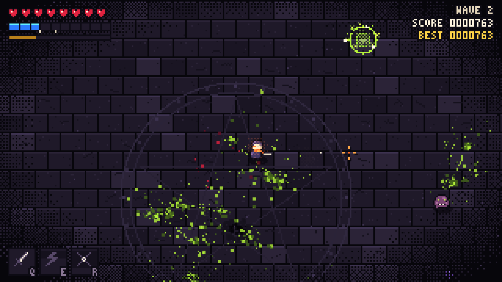

# Ashblade

A pixel-art hack and slash game you play in the browser. Pick one of seven fighters, hold the pit against endless waves, and beat four bosses on the way to the final one: the Ashen King.

## Fighters

Each fighter has a main attack, two powers (Q and E, which cost energy) and an ultimate (R, which charges as you land hits). Each one also gets its own entrance when a run starts.

| Fighter | Plays like | Q | E | R (ultimate) |
| --- | --- | --- | --- | --- |
| **Blade** | 3-hit sword combo | Rift: blink forward and cut everything you pass | Tempest: shockwave plus chain lightning | Thousand Cuts: time stops while you cut every enemy |
| **Gunner** | Hold to fire a revolver that reloads itself | Buckshot: shotgun blast with recoil | Grenade | Last Stand: 4 seconds of minigun |
| **Wizard** | Homing arcane bolts | Frost Blink: teleport and freeze enemies at both ends | Meteor | Starfall: meteors fall on every enemy |
| **Ninja** | 4-hit dagger combo, two dashes | Shuriken Fan: bouncing stars | Smoke Bomb: go invisible, and your next hit backstabs for triple damage | Shadow Clones |
| **Mechanic** | Wrench | Turret | Tesla Coil | Junk Golem |
| **Tank** | Huge, slow hammer and lots of health | Bulldoze: charge and pin enemies against walls | Ground Slam: stunning shockwaves | Fortress: 6 seconds of invincibility that also reflects shots |
| **Robot** | Laser beam that overheats | Rocket Salvo: homing rockets | Barrier: blocks 3 hits, then bursts | Orbital Laser: a beam from the sky follows your aim |

## Bosses

Every fifth wave is a boss with its own entrance and attack patterns:

1. **The Warden** (wave 5): crashes down from the sky. It sweeps, leaps and fires orb spirals.
2. **The Brood Mother** (wave 10): tunnels underground and bursts up under you. She spits acid and lays eggs that hatch.
3. **Iron Colossus** (wave 15): sweeping lasers and missile barrages. Its shield can only be broken by sending an orb back into it.
4. **The Ashen King** (wave 20, final): three phases. He blinks around and slashes, then fills the screen with fire, then turns out the lights and casts his own Thousand Cuts at you.

After the King falls you can keep going in endless mode.

## Controls

| Key | Action |
| --- | --- |
| WASD / arrows | Move |
| Mouse | Aim |
| Left click / J | Attack (hold to keep attacking) |
| Space / right click | Dash. You can't be hit during a dash, and dashing through an attack as it lands is a perfect dodge |
| Q / E / R | Powers and ultimate |
| Esc | Pause, settings, save and exit |

Slash the pink orbs to send them back. Orbs with a red ring can't be sent back.

## Features

- **Maps:** The Pit, Frozen Hollow (everything slides), Ember Forge (lava pools burn enemies), Neon Grid and Overgrown Shrine.
- **Settings:**
  - Audio: master, music and effects volume, and soundtrack choice.
  - Video: 6 color themes, vibrancy, brightness, contrast, hue shift, scanlines, screen shake, flash reduction, damage numbers and particle amount.
  - Game: 4 difficulty levels.
- **Saving:** your run saves at the start of every wave. Exit any time and pick it up again with Continue. High scores are kept for each fighter.
- **Soundtrack:** composed in code and played live, and it follows the action. A slow hymn plays on the title screen, a driving theme in combat, a harder theme in boss fights, and the King gets his own theme.

## How it's built

It's plain JavaScript modules with no libraries, no build step and no image or audio files. Everything is drawn at 320×180 and scaled up by whole numbers, so pixels stay sharp. Sprites are text grids, and the font, slashes, glows and lighting are drawn pixel by pixel. Every sound is synthesized with the Web Audio API.

The page makes no network requests and loads nothing from other sites. A strict Content-Security-Policy only allows the game's own files, and saved data is checked against the allowed values when it's loaded back.

| File | What it does |
| --- | --- |
| `src/main.js` | Main loop, screens, saving, time control |
| `src/world.js` | Combat, enemies, projectiles, hazards, drawing the arena |
| `src/chars.js` | The seven fighters and their entrances |
| `src/bosses.js` | The four bosses |
| `src/ui.js` | HUD, menus, settings, character select |
| `src/maps.js` | Arenas |
| `src/audio.js` | Soundtrack and sound effects |
| `src/sprites.js`, `src/gfx.js` | Pixel art and rendering |
| `src/upgrades.js`, `src/store.js`, `src/input.js` | Upgrades, saved data, input |
