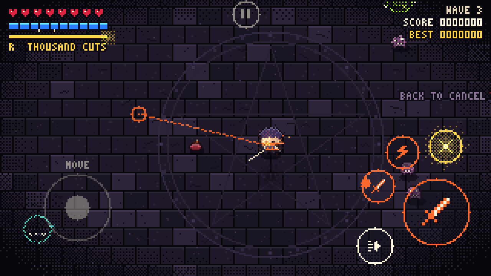

# Ashblade

A pixel-art hack and slash for the browser, on a computer or a phone. Pick a fighter and hold an arena against waves of monsters. Every fifth wave is a boss. Beating the Ashen King on wave 20 ends the story, and then the game goes endless, getting harder every wave.

**Play it at [ash-blade.vercel.app](https://ash-blade.vercel.app/).**

- 8 fighters, each with a combo, three powers, an entrance, a death scene and an awakened second look
- A large animated portrait of every fighter, on the select screen and in their entrance
- An opening where all eight fighters cut in one after another before the logo lands (any key skips it)
- 8 kinds of monsters, elites with affixes, and wave twists that change the rules
- 10 bosses, up to The Dev, the game's own developer, on wave 50
- Upgrades after every wave and a relic after every boss
- 5 arenas, 4 difficulties, phone controls, and a save at every wave

## Story

The Ashen King swallowed the sun and sealed the last of the world in a pit. Seven fighters went down after him, each for a reason of their own. An eighth was there before any of them.

## Fighters

Every fighter has a basic attack, two powers on Q and E that cost energy, and an ultimate on R that charges as your hits land.

| Fighter | Hero | Basic attack | Q | E | R |
| --- | --- | --- | --- | --- | --- |
| Blade | Kael | 4-hit sword combo | Rift: blinks forward and cuts everything on the line | Tempest: knocks enemies back and chains lightning between them | Thousand Cuts: stops time and cuts every enemy on screen |
| Gunner | Vega Hale | Revolver, reloads after 14 shots | Buckshot: an 11-pellet blast that pushes you back | Deadeye: time slows and she fires one sure critical shot at each of the 6 nearest enemies | Last Stand: 4 seconds of minigun |
| Wizard | Morrow | Homing magic bolt | Frost Blink: teleports and freezes enemies at both ends | Meteor | Starfall: meteors rain on enemies for about 3 seconds |
| Samurai | Rin | 4-hit katana combo ending in a quick-draw dash. 2 dashes, 8 health | Tsubame Gaeshi: a cut that flies out and back, hitting both ways and parrying shots | Hana Arashi: for 4 seconds a ring of petal blades cuts anything close, parries shots, and speeds her up | Issen: time stops while she cuts from enemy to enemy 11 times |
| Mechanic | Rivet | Wrench combo | Turret, up to 2 at once | Tesla Coil: zaps 3 enemies at a time for 7 seconds | Iron Titan: a giant mech lands and fights beside her for 12 seconds |
| Tank | Grom | Slow hammer combo. 12 health | Bulldoze: charges and pins enemies against walls | Ground Slam: shockwaves that stun | Fortress: 6 seconds of no damage, and shots bounce back |
| Robot | Unit-7 | Laser that overheats if held too long | Rocket Salvo: 6 homing rockets | Barrier: blocks 3 hits, then bursts | Orbital Laser: a beam from above follows your aim for 4.5 seconds |

The four melee fighters charge up when you hold attack. Let go early for a weaker version.

| Fighter | Charged attack |
| --- | --- |
| Kael | Ashen Crescent: a wide burning cut that throws a wave of fire ahead |
| Rin | Iai Dash: she flash-steps through everything ahead, parrying every shot on the way, and the cuts open a beat later |
| Rivet | Overclock Slam: the wrench smashes the floor, stuns, and arcs lightning to nearby enemies |
| Grom | Earthshatter: the ground cracks in a ring that stuns everything in it |

The eighth fighter is The Dev, a programmer in a motorized wheelchair who wrote this world and is now debugging it from the inside. He starts weaker than the others, with one shot at a time and 6 health, and grows with every wave and every 20 kills: about even by wave 15, 7.5 times as strong by wave 50. His shots plant bugs that crash an enemy.

The others awaken into a new look once per run, on their first evolution upgrade or at wave 25: Ashen Kael, Deadeye Vega, Archmage Morrow, Oni Rin, Rivet Mk-II, Titan Grom and Unit-7 Omega. Each gains 1 max health.

Each fighter also has their own sounds and their own entrance. Grom falls from the sky, Unit-7 teleports down in a beam, and Rivet breaks out of a crate.

### How they kill, and how they die

| Fighter | Kills | Death |
| --- | --- | --- |
| Kael | Enemies catch fire and turn to ash | Plants his sword and crumbles to ash. *The last ember goes out* |
| Vega | Head shots, gun smoke, a spent casing | Falls, and her dropped revolver fires one last shot into the sky. *One bullet short* |
| Morrow | Enemies unravel into arcane light | His last spell turns on him. His hat falls where he stood. *The spell was never finished* |
| Rin | A burst of petals | She fades into a storm of cherry blossoms. *She scatters with the blossoms* |
| Rivet | Enemies come apart into bolts and springs | Her suit overloads and blows. *Warranty void* |
| Grom | Enemies are flattened into a splat | His armor cracks and he falls like a wall. *The wall has fallen* |
| Unit-7 | Enemies disintegrate into pixels | Shorts out, and its head pops off on a spring. *Shutdown complete* |
| The Dev | Enemies are deleted, now and then with a 404 | A FATAL ERROR box, and he is deleted line by line. *Process terminated* |

### Unlocking fighters

You start with Blade. The select screen shows each mission and how close you are.

| Fighter | Mission |
| --- | --- |
| Gunner | Reach wave 10 |
| Wizard | Land a 100-hit combo |
| Samurai | Make 25 perfect dodges in one run |
| Mechanic | Kill 1500 enemies across all runs |
| Tank | Beat any boss without getting hit |
| Robot | Defeat the Ashen King |
| The Dev | Reach wave 50 |

## Upgrades

After every wave you pick one of three upgrades. Maxing one unlocks its evolution:

| Max this | Evolution |
| --- | --- |
| Ultimate Mastery | Your ultimate gets stronger, then you deal double damage for 8 seconds |
| Spell Mastery | Q and E cast a second time for free |
| Weapon Mastery | Basic hits release homing spirits |
| Heartwood | Survive one killing blow per wave |
| Swift Step | An extra dash, and dashing cuts every enemy you pass |
| Static Charge | Every 4th hit chains lightning to 7 enemies |
| Kindling | Burning enemies explode when they die |
| Orbit Blades | Twice the blades, on a wider orbit |

## Relics

Every boss drops three relics, and you keep one.

| Relic | Effect |
| --- | --- |
| Phoenix Feather | Once per run, rise again at full health instead of dying |
| Berserker Mark | +60% damage at half health or less |
| Storm Crown | Lightning strikes a random enemy every 2 seconds |
| Hourglass | Cooldowns 25% shorter and one more dash |
| Midas Coin | More lootlings, double energy from kills, +25% score |
| Reaper Scythe | Kills often release a soul that hunts the next enemy |
| Titan Belt | +4 max health and a full heal |
| Eclipse Stone | Your ultimate charges twice as fast |

## Monsters

| Monster | From wave | What it does |
| --- | --- | --- |
| Husk | 1 | Walks up and lunges |
| Wisp | 2 | Keeps its distance and fires pink orbs |
| Tick | 3 | Runs at you and explodes |
| Slime | 3 | Hops on you, and splits in two when it dies |
| Brute | 4 | Charges in a straight line and stuns itself on walls |
| Spitter | 5 | A rooted plant that lobs acid where you're heading |
| Shade | 8 | Disappears and reappears behind you |
| Lootling | 4 (rare) | A goblin that runs off with a sack of gold. Kill it before it digs out for energy, hearts and score |

From wave 6 some monsters are elites, with more health and one affix: Regen, Volatile, Warded, Frenzy or Split.

About one wave in three from wave 6 also comes with a twist. Survive it for a bonus.

| Twist | What changes |
| --- | --- |
| Blood Moon | Enemies are 25% faster, and kills score double |
| Swarm | Almost twice as many enemies, with half the health |
| Elite Hunt | Half the enemies are elites, and each drops a heart |
| Gold Rush | Three lootlings join the wave |
| Glass | Enemies have half health, and every hit you take costs an extra heart |
| Blackout | The lights go out except around you. 1.5x score |

Heavy hits launch bodies across the arena and knock over whatever they hit. Kills close together chain into multi-kills, up to Annihilation at 20.

## Bosses

| Wave | Boss | What it does |
| --- | --- | --- |
| 5 | The Warden | Sword sweeps, shockwave jumps, rings and spirals of orbs |
| 10 | The Brood Mother | Burrows under you, spits acid, lays eggs |
| 15 | Iron Colossus | Lasers and missiles. Its shield only breaks to an orb you knocked back |
| 20 | The Ashen King | Three phases, armored knights, rings of fire, and his own Thousand Cuts |
| 25 | Void Wyrm | A serpent that tunnels under you and breathes orbs |
| 30 | Storm Herald | Calls lightning on you and teleports |
| 35 | The Mirror | A dark copy of your own fighter |
| 40 | Eclipse | A giant eye with spirals and rotating beams |
| 45 | The Clockwork | Its clock hands sweep the arena as beams |
| 50 | The Dev | The developer himself, three times the size: RM -RF lines, fork bombs, and a Kernel Panic at 25% health |

After wave 50 all ten come back with more health. Every boss enrages after 60 seconds.

## Controls

| Action | Keyboard and mouse | Phone |
| --- | --- | --- |
| Move | WASD or arrow keys | Stick on the left |
| Aim | Mouse | Drag from the attack button. A tap aims at the nearest enemy |
| Attack | Left click or J. Hold to keep firing or to charge | Attack button |
| Dash | Space or right click | Dash button |
| Powers | Q, E, R | Tap to cast at the nearest enemy, or hold and drag to aim |
| Pause | Esc | Button at the top |

Dashing makes you untouchable. Dash through an attack as it lands and time slows, and your next hit is a counter for triple damage. Hit a pink orb to send it back.

## Settings

The game fills the window on any screen by default. Sharp mode instead zooms by whole numbers so every pixel is the same size, and there are fixed sizes from 720p to 1440p.

The other settings cover volume and music choice, color theme and screen filters, arena, difficulty, and vibration on Android phones. Screen shake, flashes, damage numbers and particles can all be turned down.

## How it's built

Plain JavaScript with no libraries and no build step. The game draws at 320×180 and scales up. The sprites are grids of characters in the code, the portraits are pixel data in script files, and the music and sound are generated in the browser with the Web Audio API. The page makes no network requests, and runs and settings save only in your browser.

| Folder | Contents |
| --- | --- |
| `src/` | The game |
| `model/` | The animated portraits: pixel data, animation code, a viewer and exports |
| `icons/` | Browser tab and home screen icons |
| `skin/` | Each fighter's current and awakened sprite as an image |
| `desc/` | A description of each fighter |
| `docs/` | Screenshots for this README |

## License

[PolyForm Strict 1.0.0](LICENSE.md). You can play it and read the code for personal, non-commercial use. You may not change it, share copies or use it commercially. For anything else, ask the author.
