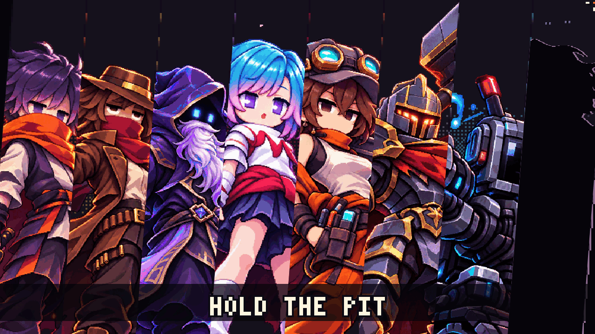
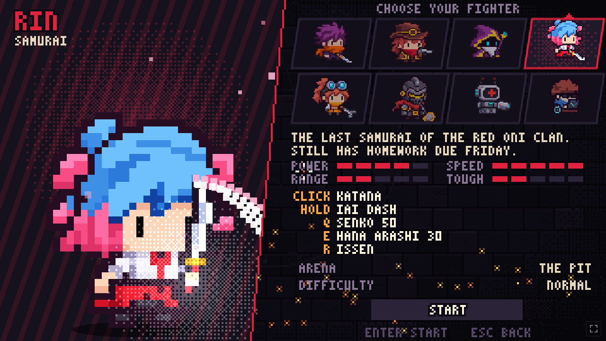
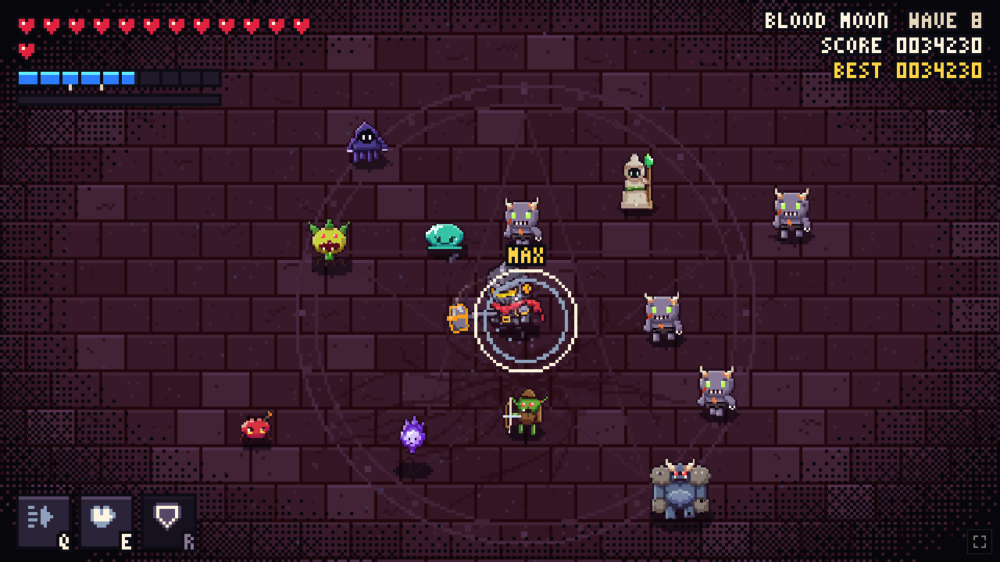
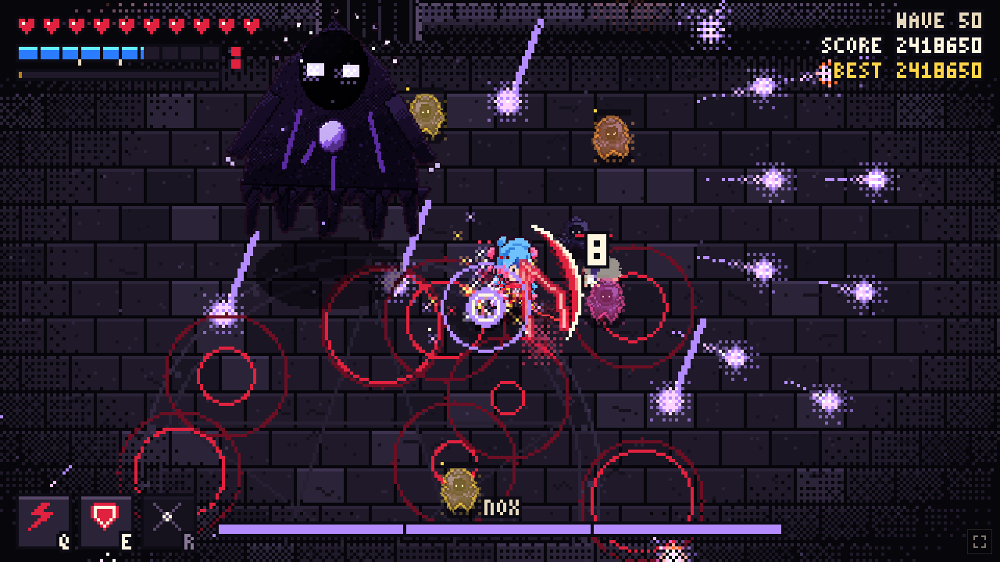

# Ashblade

A pixel-art hack and slash for the browser, on a computer or a phone. Pick a fighter and fight your way down the pit against waves of monsters. Every fifth wave is a boss, and past each boss the fight goes a floor further down, to a stage of its own. Beating the Ashen King on wave 20 frees the sun and plays the ending. Then you choose: go home and see your fighter's own ending, or go deeper into the pit, down to Nox, the dark itself, on wave 50. After Nox comes the endless night: no more waves, just monsters and returning bosses, tougher by the minute, until you fall.

**Play it at [ash-blade.vercel.app](https://ash-blade.vercel.app/).**

- 8 chibi pixel-art fighters, each with a combo, three powers, a cinematic entrance that ends on their name card and a line in their own voice, a gory death scene of their own and an awakened second look. Every fighter's weapon is held in hand and turns to wherever you aim: blades swing through each cut and guns kick back when they fire
- Fighters that move with weight: 12-frame walks and runs where the body sinks into every step and springs up on the next, the arms swing against the feet and the run leans in. Rin, the fastest, has a quick little ninja run of her own, leaning hard with her arms swept back and her katana trailing behind her. They push off in a puff of dust, skid when they turn hard or stop, throw themselves forward into a dash with speed lines and afterimages, and flinch with their eyes screwed shut when hit. Stand still for a few seconds and they show off: Kael spins his sword, Vega twirls her revolver, Morrow raises his staff, Rin flicks her katana clean, Rivet tosses her wrench, Grom heaves his hammer onto his shoulder
- A full-length portrait of every fighter on their card in the camp, in pixels three times finer than the sprites, from the owner's own High Pixel Model pictures: Kael steps in with his dagger low and his fist up, Vega aims her revolver, Morrow holds out a violet orb with his staff high, Rin points with her katana raised, Rivet shoulders her wrench with a wink, Grom carries his hammer, Unit-7 aims its arm cannon, and the Dev works his laptop from his wheelchair with code windows around him. They breathe, and their scarves, capes, coat tails, sashes, robes and hair ripple in the wind; light runs along their weapons, and lamps, screens and orbs pulse. Each stands on their own shadow, measured from their picture so it sits right under their boots, treads or wheels and darkens where each one touches the floor, lands with a burst of light in their color when picked, and has a scene and effects of their own: embers and a burning sun, a shot fired into a desert sunset, motes circling a violet orb under a star chart, petals and a flash cut under a red moon, sparks and turning gears, forge sparks off Grom's hammer under the King's torn banner, Unit-7 charging its cannon and firing it toward you, falling code
- A title screen drawn in the game's own pixels: the swallowed sun over the ruins of the pit, and an empty battlement with fire glowing through its cracks
- An opening that tells the story in illustrated pixel pages: how King Aurel swallowed the sun, and the fighters at the edge of his pit, Grom at their head, dark against its glow, as twenty torches light one by one down to his throne. Then all eight fighters cut in one after another, and the logo slams down over the empty battlement. Any key or tap turns a page. Press Escape or tap Skip to leave the story. The **Ash Story** entry on the title screen is the voice in the ash telling his own story in eight illustrated pages: the baker of Mill Street whose girl drew a sun in the flour every morning, the King reaching from his tower as the sun dims, the last light crossing the rooftops and disappearing into his mouth, the morning their hands turned grey, the march into the pit, the little sun she still draws in the ash, the fighters at the edge, and the morning that sets them free. In the game the ash is everywhere while the King lives: it blows through his floors, and every monster you kill goes up as ash, now and then with a spark of gold set free. Once the sun is out his people are free, and below the pit the monsters are the dark's own and come apart into it.
- A story told while you fight: the Ashen King taunts you and tells you who he was, a voice in the ash begs you to free his people, every fighter answers in their own words, and past wave 20 the dark itself talks. When the King falls, an illustrated ending plays, then a comic page of your victory and two roads: go home to your fighter's own ending, or go deeper. Falling down there has a story of its own
- 12 kinds of monsters, drawn in the fighters' own style and pixel size (big heads, a dark plum outline, flat bands of light and shadow), including an archer whose aim you can see and a priest that heals the others, a bellwraith with a double shockwave and a glasswing that fires bouncing shards, plus elites with affixes and wave twists that change the rules. Every monster and boss moves through 48 frames a cycle (Nox's two forms, the biggest, through 24), and every kill breaks a monster apart pixel by pixel
- 10 bosses, up to Nox, the dark under the pit, on wave 50, then the endless night, where they come back one at a time and later two at a time. Each has a trick no other boss has: the Warden chains you, the Brood Mother webs the floor, the Colossus's shield only breaks to its own shot knocked back, the King orders you to kneel, the Wyrm swallows you whole, the Herald charges the floor, the Mirror turns you around, the Eclipse turns you to stone, the Clockwork stops time for you, and Nox breathes you in
- Pick an upgrade between waves and a relic after a boss. Defeating Nox grants every remaining upgrade your fighter can use.
- A soundtrack made in the browser: an epic title theme with war drums, a choir, running strings and a horn, a sad flute theme for the story, a hopeful dawn theme for the ending, hard-hitting battle music and a theme for every boss. Every story page has sounds of its own (the sun's bells, the swallowing, the army's drums, a horn as the torches light, the seal breaking, bells for the fallen), and the fight sounds land: kills break into a crackle of pixels with a chime that climbs the scale as your combo grows, pickups climb the same scale, a horn opens each wave, and the music dips for an instant under every big hit
- A new stage on every floor of the pit, each built for the boss at its end: the Brood Mother's webbed nest, the Ashen King's hall with his carpet and banners, the broken stone the Void Wyrm swims through, a hall of mirrors, a sun temple with an eclipse laid in the floor, the Clockwork's gears and a floor of stars under Nox.
- The Last Camp: before a run the camera looks over a campfire at the rim of the pit, wider than the screen, where all eight fighters sit. Point at one and choose it to see their card: their high pixel portrait on the left, their numbers, powers and records on the right. Lock them in and the camera comes down to fight size and you can walk with the keys, tap a destination or drag to steer; Escape goes back to choosing. Walk up to the others to talk to them (what they say changes once they have beaten the King), and watch how they feel in little bubbles. Fighters you haven't unlocked sit there as ash statues that tell you what wakes them. Read the Compendium on the old stone, set the difficulty at the war standard, train at the dummy, take the day's missions at the quest board, trade with the three shopkeepers (drawn from the owner's own pictures of them), and walk into the pit to begin. Ash statues of the King's people stand around the camp, frozen as they were when the ash came, beside the fallen head of his great statue
- The Compendium: every fighter (and their awakened powers, once you've seen them), every monster you've killed, every boss you've beaten, every floor you've reached, every ending you've seen (watch them again from here), and your records
- Training on your very first run: wave 1 teaches you to move, attack, dash, charge, use your powers and your ultimate, a step at a time, on monsters sealed against everything but the move you're learning (a ring and a key over each shows which). The lesson sits small in the top left corner, out of the fight's way. Nothing can hurt you while you train, dashes and powers cost no energy, and Tab skips it. The camp's dummy runs it again in the camp's own training yard (packed earth, straw dummies, hay bales and targets to smash), with no story and nothing saved
- Gold, and it is rare: a lootling drops two coins, now and then something you smash drops one, the run pays out when it ends (more the deeper you got and the harder the difficulty), and the quest board's three daily missions pay the rest. Spend it in the camp: permanent upgrades for each fighter at the Smith, decorations at the Peddler, and ten camp maps and eight fighter outfits at the Black Market
- Things to break on every floor: boxes of twelve kinds anywhere (crates in four woods, some with a painted mark, iron-bound crates, long crates, crates stacked two high, painted cargo boxes, slatted crates of apples, crates under roped tarps, lockboxes, barrels, sacks and baskets of fruit), and on each floor two things of its own (urns of bones in the Pit, cocoons in the Brood Nest, powder kegs in the Forge that blow up and set each other off, blocks of ice with something frozen inside, glass vases and mirror panes, braziers, clocks...). Every attack breaks them, dashing through smashes them, and their pieces fly, bounce and settle as rubble in the box's own colors. A fresh set of 26 to 32 is laid out on every new floor, and as each later wave on it starts a few more boxes drop in from above
- Expressions: fighters, monsters and bosses show what they feel in little pixel bubbles. A ! when a boss comes, sweat when you're nearly dead, anger when you're hit hard, a tune after a wave, stars over anything stunned, a boss's anger when it turns to a new phase, and a nap if you stand still long enough
- 4 difficulties, a save at every wave, and phone controls on a screen that fills the whole phone, edge to edge

## Story

Aurel was the Sun King, and his kingdom lived in its light. When the sun grew old and dim he feared the dark that waits for everything, so he swallowed the sun whole, to burn forever. The sky went black, the land turned to ash, and he became the Ashen King. Every night his army of ash climbs out of the pit below his throne.

Eight fighters go down into the pit, each for a reason of their own: Kael carries the last ember of the old sun in his blade, Vega followed one bounty too deep, Morrow traded his face for the names of the stars, Rin is the last samurai of the Red Oni clan (with homework due Friday), Rivet builds her weapons from what the Colossus left behind, Grom is the last knight of the King's guard come back to end what he served, Unit-7 woke up with one order left, and the Dev wrote this world and is debugging it from the inside. The goal of a run: fight down through 20 waves, floor by floor, to the throne at the bottom, kill the Ashen King on the twentieth, and cut the sun out of him. He speaks to you on the way down: when the run begins, between his bosses, where he tells you who he was a piece at a time, when each of his bosses arrives and dies, when you are close to death or fighting too well, and face to face before the last fight. Your fighter answers him every time, in their own voice. Between his speeches a voice in the ash speaks too: the monsters you have been cutting down were his people, and they ask you to set them free. If you fall, he has a last word over your body.

The story is told in moving pictures. In the opening Aurel lifts a shaking hand toward the dying sun, lets it fall and holds his chest as the dark closes in; he raises both arms, pulls the sun down into his chest, doubles over as it burns in him and throws his head back in its fire; then he stands on a crag over his army raising his arm, and lifts it again on his throne as the last torch lights. When he falls, his arms are flung back as the light splits him and he goes down on his knees, reaching for the sun as he turns to ash. Each turned page burns away from the bottom up into the next one, an edge of embers eating through it.

The story never talks over a fight. When something important is said, the fight stops and the words appear in a box along the bottom of the screen, with the speaker's face; press Enter or Space, click or tap to read on, and Escape skips the rest. Taunts, quips and a boss's arrival are a small box at the top that comes and goes while you keep fighting.

When he falls the sun breaks out of him, his people burn away into light, and Aurel looks at the sun one last time, no longer afraid of the dark. The light comes back to the land and your fighter has the last word. Then a comic page shows what you won, and you choose:

- **Go home.** Each fighter gets four animated pages of their own. Kael cuts the ash clouds over Mill Street, frees his family's ember and hears his grandmother sing to the sun. Vega shoots the lock off a town bell, spends the bounty on the town and follows a flare at sundown. Morrow catches five falling stars, casts them back as a swallow and finds his face again. Rin draws her katana through the seal on the Red Oni gate, finds her shrine in bloom and sprints to school with her scorched homework. Rivet and Big Guy winch up the Colossus core and wire its generator into the town windmill. Grom holds a falling gate until the last family is clear, then lays his hammer on Aurel's tomb. Unit-7 shields a child from a collapsing roof and tends the flower they give it for a thousand sunrises. The Dev writes a bridge into existence under his wheels, leads the survivors across and puts them in the credits.
- **Go deeper.** The King's fire was what kept his pit sealed. With it out, the seal breaks, and the dark he was always afraid of opens its eyes underneath. If it reaches the surface the new dawn dies, so your fighter turns away from the light and goes down. The run goes on, and the dark talks to you now. On wave 50 it rises out of the floor with a shape and a name, Nox, the night after the last night, and every fighter answers it. Nox cannot truly die: when its shape breaks, everything it ever swallowed climbs back out of it, and the endless night begins. Fall down there and the story tells how long you held it back while the sun rose above.

## Fighters

Every fighter has a basic attack, two powers on Q and E that cost energy, and an ultimate on R that charges as your hits land. Press R at full charge and it goes off at once while your fighter lets out a short battle cry over it: Kael “Burn!”, Vega “Eat lead!”, Morrow “Stars, fall!”, Rivet “Smash 'em!”, Grom “Stand fast!”, Unit-7 “Fire!”, the Dev “Delete!”. Rin still shouts the name of her move, 「霹靂一閃！」 (Hekireki Issen!). The effects volume controls the voices.

| Fighter | Hero | Basic attack | Q | E | R |
| --- | --- | --- | --- | --- | --- |
| Blade | Kael | 4-hit sword combo | Rift: blinks forward and cuts everything on the line | Tempest: knocks enemies back and chains lightning between them | Thousand Cuts: Kael stops time and carves through up to 14 enemies |
| Gunner | Vega Hale | Revolver, reloads after 14 shots | Buckshot: an 11-pellet blast that pushes you back | Deadeye: crosshairs lock on and she fires one sure critical shot at each of the 6 nearest enemies | Last Stand: 4 seconds of minigun |
| Wizard | Morrow | Homing magic bolt | Arcane Missiles: a rune circle flares and 5 homing missiles leave his staff | Blizzard: a 3-second frost storm where you aim that cuts and freezes everything in it | Starfall: meteors rain on enemies for about 3 seconds |
| Samurai | Rin | 4-hit katana combo ending in a quick-draw dash. 2 dashes, 7 hearts | Senko: a beam of light shoots from her sword across the arena in an instant, hitting everything on the line for huge damage and destroying shots. Costs 50 energy | Hana Arashi: for 4 seconds a ring of petal blades cuts anything close, parries shots, and speeds her up | Issen: Rin chains 11 cuts between frozen enemies. When she sheathes her blade, the marked foes burst into petals |
| Mechanic | Rivet | Wrench combo | Turret, up to 2 at once | Tesla Coil: zaps 3 enemies at a time for 7 seconds | Iron Titan: a giant mech lands and fights beside her for 18 seconds, punching, firing missile salvos and ground-pounding to stun |
| Tank | Grom | Slow hammer combo. 11 hearts | Bulldoze: charges and pins enemies against walls | Ground Slam: shockwaves that stun and wipe out enemy shots | Fortress: 6 seconds of no damage, and shots bounce back |
| Robot | Unit-7 | Laser that overheats if held too long | Rocket Salvo: 6 homing rockets | Barrier: blocks 3 hits, then bursts | Orbital Laser: a beam from above follows your aim for 4.5 seconds |

The four melee fighters charge up when you hold attack. Let go early for a weaker version.

| Fighter | Charged attack |
| --- | --- |
| Kael | Ashen Crescent: a wide burning cut that throws a wave of fire ahead and knocks shots back |
| Rin | Iai Dash: she flash-steps through everything ahead, parrying every shot on the way, and the cuts open a beat later |
| Rivet | Overclock Slam: the wrench smashes the floor, stuns, arcs lightning to nearby enemies, and knocks shots back on the way down |
| Grom | Earthshatter: the hammer knocks shots back, the ground cracks in a ring that stuns everything in it, and the shockwave wipes out every enemy shot it rolls over |

The eighth fighter is The Dev, a programmer in a motorized wheelchair who wrote this world and is now debugging it from the inside. He starts weaker than the others, with one shot at a time and 7 health, and grows with every wave and every 20 kills: about even by wave 15, 7.5 times as strong by wave 50. His shots plant bugs that crash an enemy.

Pink afterimages trail behind Rin when she runs. She wears her katana sheathed at her hip: swinging, charging, a power or running flat out draws it, and a moment after she's done she flicks it clean and slides it home with a click. The first cut out of the scabbard is a quick draw (IAI): a flash along the cut and a sure critical hit, half again as hard. Her **Flash Strike**: the first sword swing or skill within 0.6 seconds after a dash does 2.5 times the damage, so a dash into Senko hits for well over 200.

Every fighter awakens after taking four evolutions in a run. The banner tracks progress from AWAKENING 1/4 to 4/4. Awakening grants one extra maximum heart and the powers below. Your equipped outfit and weapon stay on, including when you resume a saved run.

The Black Market sells a permanent outfit for each fighter for 1,000 gold. Ashen Kael wears a gold scarf, Deadeye Vega a black coat and crimson bandana, and Archmage Morrow a gold-trimmed robe. Oni Rin wears her red bow and carries a red-edged katana across her hip. Rivet Mk-II has gold goggles, Titan Grom has black plate and a red visor, Unit-7 Omega has a gold shell, and Root wears a black hoodie. You can preview both looks in motion and switch freely after purchase.

- **Effects:** slashes, shots, beams, particles and powers switch to an awakened color scheme, drawn thicker, with an extra glowing spark on every effect, a sparkling trail behind every shot, a colored ribbon behind every swing, and a weapon that smoulders all the time.
- **Basic attack:** 30% more damage, plus an extra effect on every hit.
- **Melee swings:** every awakened swing leaves a second, wider arc and adds the fighter's own extra: Ashen Kael throws flame crescents, Oni Rin sends gold blade waves, Rivet Mk-II arcs lightning forward, and Titan Grom rolls blood-red shockwaves along the ground, with his slam and spin ending in a quake ringed by eruptions.
- **Charged attack:** a double ring spins at the feet while charging, and the release bursts in the fighter's awakened colors. Ashen Kael throws five crescents and a line of white fire erupts along the cut. Oni Rin fans eight gold waves out of her dash, then a second cut opens along it. Rivet Mk-II calls a ring of lightning strikes and a long chain. Titan Grom sends three aftershocks and a ring of eruptions.
- **Q and E:** cost a quarter less, recharge a fifth faster, and release an awakened burst after each cast.
- **Ultimate:** 30% more damage, an awakened finisher, and it keeps 30% of its charge. It also charges a quarter faster.

| Awakened | Basic hits | After Q and E | After the ultimate |
| --- | --- | --- | --- |
| Ashen Kael | Set enemies on fire | A ring of fire | The whole screen burns |
| Deadeye Vega | Shots ricochet to the next enemy | A fan of 10 gold rounds | A homing volley at up to 10 enemies |
| Archmage Morrow | Bolts arc to a second enemy | Lightning on the 3 nearest enemies | Lightning on 8 enemies |
| Oni Rin | A petal cut opens a beat later | A ring cut that parries every shot near her | The blossom storm rises around her for free |
| Rivet Mk-II | Every third hit arcs to two more enemies | A tesla chain through 5 enemies | A 10-enemy chain and lightning strikes |
| Titan Grom | A shockwave through the enemies around the target | A quake that stuns | A great quake that stuns everything near |
| Unit-7 Omega | The laser scorches | 3 homing mini-rockets | A ring of 8 homing rockets |
| Root | Each hit forks a bug into a nearby enemy | Crashes the 3 nearest enemies | Glitches everything in range |

Each fighter also has their own sounds and an entrance of about three seconds in a letterbox, ending on their name card as they say their line. Any attack key, Space, Enter or a tap skips it.

| Fighter | Entrance | Line |
| --- | --- | --- |
| Kael | The sky darkens and he crashes down as a burning meteor, ringed by pillars of fire, then sweeps his sword all the way round | “The ember still burns.” |
| Vega | High noon: a bell, dust on the wind, a tumbleweed. She drops in spinning and firing all round, lands in falling brass, twirls her revolver and fires once at the sky | “Time to collect.” |
| Morrow | A summoning circle draws itself rune by rune, a pillar of violet light comes down into it, and he floats down inside it as it bursts | “The stars answer me.”, an old man’s voice |
| Rin | Petals storm across while her afterimages cut the air. She appears in a burst of sakura smoke, flicks her blade clean, and every cut left in the air bursts at once | 「いざ、参ります！」 (Iza, mairimasu! Here I come!) |
| Rivet | A drop pod slams down on a target marker, vents steam and blows open in golden smoke, and she slams her wrench into the floor | “Let's get to work!” |
| Grom | The ground shakes under a growing shadow, he falls hammer first, and the floor splits into glowing cracks and rock spikes | “My oath is not done.”, a deep knight’s voice |
| Unit-7 | Scan lines, DEPLOYING UNIT-7 and a countdown, then an orbital beam. It builds itself up row by row inside it and powers on | “Unit Seven, online.” |
| The Dev | Code rains and a terminal compiles him. ACCESS GRANTED, the window shuts off like an old screen, and he renders in from coarse blocks | “Time to debug.” |

### How they kill, and how they die

| Fighter | Kills | Death |
| --- | --- | --- |
| Kael | Enemies catch fire and turn to ash | Cut in two: his top half slides off, his legs fold, both halves burn to ash, and his sword stays standing in the floor. *The last ember goes out* |
| Vega | Head shots, gun smoke, a spent casing | Riddled with bullets, the last one takes her hat off. On her knees she fires one last shot at the sky, then falls into her own blood. *One bullet short* |
| Morrow | Enemies unravel into arcane light | His own spell lifts him up and tears him into burning pieces that rain down with his blood. *The spell was never finished* |
| Rin | A burst of petals | Six cuts flash across her, then she falls apart along all of them at once, and the pieces scatter into petals. *She scatters with the blossoms* |
| Rivet | Enemies come apart into bolts and springs | Her rig overloads and blows her apart, head and chest flying, and her machines go up with her. *Warranty void* |
| Grom | Enemies are flattened into a splat | A giant hand rises through the floor, closes around his armor and crushes him in its fist |
| Unit-7 | Enemies disintegrate into pixels | Its head pops off on a fountain of oil, the body counts down from three and blows itself to scrap. *Shutdown complete* |
| The Dev | Enemies are deleted, now and then with a 404 | A FATAL ERROR box, and he is deleted line by line. *Process terminated* |

### Unlocking fighters

You start with Blade. In the camp, a fighter you haven't unlocked stands as an ash statue: walk up to it to see its unlock mission and your progress. Fighters who reach the endless night also show their best survival time.

| Fighter | Mission |
| --- | --- |
| Gunner | Reach wave 10 |
| Wizard | Land a 100-hit combo |
| Samurai | Make 25 perfect dodges in one run |
| Mechanic | Kill 1500 enemies across all runs |
| Tank | Beat any boss without getting hit |
| Robot | Defeat the Ashen King |
| The Dev | Reach wave 50 |

## Upgrades

Between waves you pick one of three cards. Press **Tab** or tap a card’s **Info** button to compare its effects before choosing. Max out an upgrade to find its evolution. Four evolutions awaken your fighter.

| Max this | Evolution |
| --- | --- |
| Weapon Mastery | Spirit Strikes: basic hits release homing spirits |
| Spell Mastery | Arcane Echo repeats Q and E twice for free |
| Ultimate Mastery | Your ultimate gets stronger, then you deal double damage for 8 seconds |
| Whetstone | Razor Edge: all damage +30% more |
| Quickhand | Frenzy: attack speed +25% more |
| Long Edge (melee) | Giant's Reach: melee reach +30% more |
| Keen Eye | Deathmark: +15% crit chance, and crits deal triple damage |
| Heartwood | Undying: survive one killing blow per wave |
| Swift Step | Blink Storm: an extra dash, and dashing cuts every enemy you pass |
| Phantom Step | Shadow Step: dash cuts hit three times harder |
| Mirror Guard (melee) | Reflect All: parried shots home in on enemies |
| Deep Well | Wellspring: energy refills 60% faster again |
| Lodestone | Lifeline: energy refills 30% faster, +1 max health |
| Blood Debt | Blood Pact: heal 1 health every 10 kills |
| Static Charge | Thundergod: every 4th hit chains lightning to 7 enemies |
| Kindling | Inferno: burning enemies explode when they die |
| Shrapnel | Cluster Blast: explosions 50% bigger again |
| Executioner | Guillotine: enemies under 35% health take double damage |
| Orbit Blades | Blade Storm: twice the blades, on a wider orbit |
| Thorns | Bramble: the blast when you're hit is twice as strong |

Each fighter's own upgrades evolve too:

| Fighter | Upgrade → evolution |
| --- | --- |
| Kael | Rift Echo → Rift Master (powers +25% damage, cooldowns -20%). Storm Heart → Eye of the Storm (Tempest jumps to 3 more) |
| Vega | Extended Mag → Bottomless Mag (+100% ammo). Hollow Points → Railgun (bullets pierce 3 more) |
| Morrow | Frostbite → Absolute Zero (frozen enemies take double damage). Twin Cast → Arcane Storm (12 missiles, a huge blizzard) |
| Rin | Third Step → Fourth Step (+1 dash). Venom Edge → Death Blossom (poison burns twice as hard) |
| Rivet | Overclock → Hyperclock (turrets and coils fire faster still). Extra Hands → Assembly Line (+2 turrets) |
| Grom | Aftershock → Earthquake (ground slam sends 2 more waves). Iron Skin → Adamant (+5 max health and a full heal) |
| Unit-7 | Coolant → Cryo Core (the laser heats 75% slower). Cluster Pods → Swarm Pods (+6 rockets per salvo) |
| The Dev | Fork Bomb → Recursion (a crash needs 1 fewer bug). Stack Overflow → Segfault (all damage +25%) |

## Relics

After a boss, you can choose one of the remaining relics. Nox grants them all when you defeat its awakened form.

| Relic | Effect |
| --- | --- |
| Phoenix Feather | Once per run, rise again at full health instead of dying |
| Berserker Mark | +60% damage at half health or less |
| Storm Crown | Lightning strikes a random enemy every 2 seconds |
| Hourglass | Cooldowns 25% shorter and one more dash |
| Midas Coin | More lootlings, double energy from kills, +25% score |
| Reaper Scythe | Kills often release a soul that hunts the next enemy |
| Titan Belt | +4 max health and a full heal |
| Eclipse Stone | Your ultimate charges twice as fast |

## Gold and the camp

Gold is rare and things are dear. It comes four ways:

- **Lootlings:** each one you kill drops two coins.
- **Things you break:** one in ten drops a coin (and one in thirty-three a heart).
- **The run's payout,** worked out when the run ends and shown on the last screen: a coin for every four floors' worth of waves, one for each boss (three more for the King, five for Nox), one for every two minutes of the endless night and one for every 250 kills. Easy pays half, Hard half again, Nightmare double.
- **The quest board:** three missions a day, the same for everyone that day (kill so many monsters, beat bosses, reach a wave, land a combo, perfect-dodge, smash things, squash critters...). Progress counts in every real run that day, and the pause screen shows how far along each one is; claim the gold at the board.

Practice and training earn nothing. In the camp:

| Who | What they sell |
| --- | --- |
| The Smith, at the forge | Permanent upgrades, each fighter's own: Vitality (+1 heart, 3 levels), Might (+8% weapon damage, 3), Spirit (+12% energy, 3), Fury (+12% ultimate charge, 3) and Stride (dash 10% sooner, 4% faster, 2). Reset takes that fighter's upgrades back and returns every coin they cost |
| The Peddler, at his cart | Preview all 23 decorations in their actual camp locations before buying. They include a stew pot bubbling over its fire, flowers with a butterfly, a weapon rack, glowing mushrooms, an old terminal, a cat asleep by the fire, a tavern corner, a raven on a dead branch, lantern strings, a star telescope, a cherry tree, Rivet's workbench, a wishing well, a little windmill, a war table, a shrine gate, the King's tomb, a koi pond, sun banners, Grom's old armor, an ember fountain, a floating starstone and an empty throne. Put one away and set it out again for free. Reset puts everything away at once |
| The Black Market | Preview and equip ten camp maps, including Frozen Hollow, Cherry Blossom and Golden Dawn. The Fighter Outfits tab shows each original and alternate skin side by side. Each alternate costs 1,000 gold and comes with its matching weapon where applicable. |

Each reset button sits under its shop's list and asks first: press it (or R) a second time within a couple of seconds to go through with it.

Every fighter now starts a little weaker than before (one heart less, 15% less weapon damage and energy, 12% slower ultimate), and the Smith's work makes them stronger than they ever were.

The camp remembers your last run. Come back to the fire and one of the others has something to say about it: a word of comfort after an early fall, your wave number after a deeper one, cheers and hearts all round the fire once the King is beaten, and a second voice when you set a new best. Between runs the fighters talk among themselves now and then (only the ones awake; a statue stays quiet). The camp tells you what the last run brought home, and an arrow over the pit shows where the next one begins.

## Monsters

Walking monsters plant their feet as they slow down. Wisps flicker, slimes pulse, and the Void Wyrm’s body follows its head around corners. The painted monsters and bosses have 24 poses per cycle. The Mirror borrows your fighter’s idle, walk and run animations.

| Monster | From wave | What it does |
| --- | --- | --- |
| Husk | 1 | Walks up and lunges |
| Wisp | 2 | Keeps its distance and fires pink orbs |
| Tick | 3 | Runs at you and explodes |
| Slime | 3 | Hops on you, and splits in two when it dies |
| Ash Brute | 4 | Once a smith of Aurel's city: a towering giant of cracked, ember-lit ash with a bull's head and an iron forge gauntlet, stomping toward you face-on like the fighters stand. To charge it turns side-on, drops into a hunch, lowers its horns and paws the ground, then charges in a burning line; it stuns itself on walls and on the floor's obstacles |
| Spitter | 5 | A rooted plant that lobs acid where you're heading |
| Archer | 4 | A hooded goblin with a bow. It keeps its distance, then draws and aims, and a dashed red line shows exactly where the arrow will fly: it follows you while the bow is drawn, then locks and flashes white just before the shot. Arrows can be parried |
| Ash Priest | 6 | A robed healer that stays behind the others. It chants inside a green circle, tethered to every wounded monster in it, then heals them by 30%. Hit it mid-chant to break the spell |
| Shade | 8 | Disappears and reappears behind you |
| Lootling | 4 (rare) | A goblin that runs off with a sack of gold. Kill it before it digs out for two gold coins, energy, a heart and score |
| Bellwraith | 21 | Chimes before sending two shockwaves across the floor. Time a dash for each ring. |
| Glasswing | 26 | Hovers at range, fires three glass shards that bounce off the walls, then recoils out of reach. |

From wave 6 some monsters are elites, with more health and one affix: Regen, Volatile, Warded, Frenzy or Split.

About one wave in three from wave 6 also comes with a twist. Survive it for a bonus.

| Twist | What changes |
| --- | --- |
| Blood Moon | Enemies are 25% faster, and kills score double |
| Swarm | Almost twice as many enemies, with half the health |
| Elite Hunt | Half the enemies are elites, and each drops a heart |
| Gold Rush | Three lootlings join the wave |
| Glass | Enemies have half health, and every hit you take costs an extra heart |
| Blackout | The lights go out except around you. 1.5x score |

Monsters have nerve, up to a point. A triple kill or an elite cut down makes the ones close by sweat and back away from you for a moment; the closest one hums a little tune when you get hit; now and then one spots you as it climbs out; and when you fall, the ones nearby celebrate. When only a few monsters are left and they are off the screen, small arrows at the edge point the way. Every hundred hits in a row pays out a golden burst and a full energy bar.

Every floor has its own small life: rats in the Pit, spiderlings in the Brood Nest, fire beetles that don't mind the lava in the Ember Forge, crows in the Ashen Throne, glowing mites in the Void Deep, snow mice in the Frozen Hollow, glass crabs scuttling sideways in the Glass Hall, scarabs in the Sun Temple, clockwork beetles in the Clockworks, moths in the Last Night and hens in the camp's training yard. They mind their own business, run from you and from big monsters, scatter from blasts, take to the air if they can, and hide in the cracks while a boss is on the floor. A stray cut, shot, blast or dash squashes them, for a few points.

Monsters die in pixels. A cut splits a monster along its own pixel grid, and both halves fly apart and crumble from the wound outward, shedding square chips that bounce on the floor; any other kill dissolves it pixel by pixel from the side the blow came from. Heavy hits launch bodies across the arena, tumbling a quarter turn at a time and knocking over whatever they hit, until they shatter. Kills close together chain into multi-kills, up to Annihilation at 20.

## Bosses

Torchlight pools on the arena floor. Fighters and bosses cast directional shadows, and a lightning strike briefly lights the ground around its impact.

Every boss announces itself before it appears, and the camera turns to the spot, and what its arrival leaves behind fades away slowly once it is here: the Warden's lantern comes down on its chain over a pink seal, the floor heaves and webs shoot out for the Brood Mother, a drop zone beeps under the Colossus's growing shadow until it slams down, a crown of fire rises for the King, the Wyrm's fin circles under rippling stone, a storm strikes lightning on the Herald's spot, copies of your own fighter fold into the Mirror, a black disc slides over the sun for the Eclipse, a clock face spins backwards for the Clockwork, and for Nox the light dies, tendrils of night crawl out and two eyes open. Then the boss itself comes in its own way, never all at once: the Warden crashes down out of the sky, the Brood Mother lowers on her thread until it snaps, the Colossus falls onto its drop zone and powers on, the King rises out of the floor inside a pillar of fire, the Wyrm bursts up out of the stone, the Herald comes down inside a bolt of lightning, the Mirror grows out of glass shards, the Eclipse darkens out of the sky as a black shape that takes its colors as its eye opens, the Clockwork rises out of its clock face and chimes, and Nox rises out of the floor as it comes out of the dark.

| Wave | Boss | What it does |
| --- | --- | --- |
| 5 | The Warden | A horned jailer in violet armor carries a swinging soul lantern. Sword sweeps, shockwave jumps, rings and spirals of orbs. His chain: thrown from his lantern hand, it hooks you and reels you in for the sword. Dash three times to snap it |
| 10 | The Brood Mother | A spider queen the size of a cart. She comes down out of the dark on a thread of silk, hangs there, and lands when it snaps, her eggs hatching round her. She climbs back into the dark and drops on you (her shadow follows you, then stops: move), spits acid, lays eggs, sends her young. Her webs: globs of web stick to the floor and hold your feet to less than half speed (a dash still gets you out) |
| 15 | Iron Colossus | An armored war engine hovers on jets beneath its orange furnace, with a rocket fist on each arm. Lasers from its visor, missiles, rocket fists, and a slam: it climbs on its jets and drops onto the floor. Its shield only breaks to an orb you knocked back |
| 20 | The Ashen King | Aurel himself. He talks to you before the fight, then three phases, armored knights, rings of fire, and his own Thousand Cuts. His decree, KNEEL: he raises his sword and fire falls everywhere but where you stand. Move or dash and it comes down on you. In his last phase he tears open the black sun in his chest and two beams of its fire sweep round the hall |
| 25 | Void Wyrm | A serpent with horns of void crystal and a jaw that snaps open and shut, its armored body ridged with crystal, that tunnels under you and breathes orbs. If it comes up right under you, it swallows you: six hits from inside cut you free and leave it stunned, or it spits you out hurt |
| 30 | Storm Herald | A winged knight in blue armor channels the storm through a crystal staff. Calls lightning on you and teleports. His war horn throws a cone of thunder that knocks you back and sends slow ball lightning after you. He charges the floor into a checkerboard: the squares you stand on strike first, then the others, turn and turn about |
| 35 | The Mirror | A dark copy of your fighter. It swaps places with you and reverses movement. It studies your weapon attacks, casts, dashes and distance, then chooses a counter. Frequent dashes teach it where to mark your next landing. |
| 40 | Eclipse | A black sun in a burning corona, a great red-veined eye in its middle, rune stones circling it. A giant eye with spirals and rotating beams. Its stare is a cone of light that turns after you: stand in it too long and you turn to stone |
| 45 | The Clockwork | A floating brass automaton: a clock face for a chest, gears turning behind it, winding keys for hands and a pendulum swinging under it. Its clock hands sweep the arena as beams. Its stopwatch: a dial under your feet with a hand sweeping round it. Still on it when the hand gets back to twelve, and time stops for you while shots close in |
| 50 | Nox | Nox rains dead stars, summons shades and sweeps the floor with beams from the corners. Its limbs lash out of cracks in the floor, and its Night Loom splits the floor into lines and weaves tentacles in and out of them: stand between the cracks. Break all three health segments and a larger, tentacled form rises. Roots of the dark crawl out from under it. Slip between them, and when its Last Light rolls out across the floor, shelter in the unblinking eye. When this form falls, Nox scatters into ash. |

Every boss enrages after 60 seconds. Every boss is big, the Ashen King and Nox most of all, and the camera pulls back toward them so you can see them whole.

### The floors

Every floor has things to break laid out on it (see Gold and the camp), and things standing on it that block the way and stop shots, so you can hide from them and knock monsters into them: broken pillars in the Pit, frozen soldiers in the Hollow, glowing anvils in the Forge, webbed egg clutches in the Nest, the columns of the King's hall hung with his sun banners, void crystals, standing mirrors, sun obelisks, turning gears and fallen dead stars. Flying things go over them.

In **The Descent**, every boss waits at the bottom of its own floor. The next wave takes you a floor deeper, with a short arrival of its own in a letterbox, ending on the floor's name: you fall through the Brood Nest's webs snapping strand by strand, crash into the Forge as its lava pools blow, walk in through the King's gate down his carpet as the torches flare and kneel, drop out of a rift into the Void Deep, slide in on the Hollow's ice in a blizzard, step out of a shattering mirror into the Glass Hall, are lowered by a shaft of sunlight into the Sun Temple, land on a gear lift in the Clockworks, and fall into the Last Night as a falling star. Below the pit, the dark greets you on each new floor, and your fighter answers it in their own words. The forge has lava you can knock monsters into, and Frozen Hollow puts ice under your feet.

| Depth | Waves | Floor | Boss |
| --- | --- | --- | --- |
| 1 | 1 to 5 | The Pit: stone, torches and old blood | The Warden |
| 2 | 6 to 10 | The Brood Nest: webs in the corners, clutches of eggs, puddles of acid, rising spores | The Brood Mother |
| 3 | 11 to 15 | Ember Forge: lava pools and floating ash | Iron Colossus |
| 4 | 16 to 20 | The Ashen Throne: the King's carpet down the hall, his banners, ash heaped by the walls | The Ashen King |
| 5 | 21 to 25 | The Void Deep: glowing fissures and the holes the Wyrm swam out of | Void Wyrm |
| 6 | 26 to 30 | Frozen Hollow: ice underfoot and a snowstorm | Storm Herald |
| 7 | 31 to 35 | The Glass Hall: mirror tiles in a silver lattice, glinting | The Mirror |
| 8 | 36 to 40 | The Sun Temple: an eclipse laid in the floor in gold | Eclipse |
| 9 | 41 to 45 | The Clockworks: brass gears and a clock face in the floor | The Clockwork |
| 10 | 46 to 50, then the endless night | The Last Night: a floor of stars under a pale crescent | Nox |

### The endless night

When Nox dissolves, the inheritance sequence grants every remaining rank, evolution and relic your fighter can use. The endless night begins, in the dark itself: no walls, no floor, no edge, only stars far below and black glass underfoot that ripples where you step, going on for ever in every direction. Packs grow larger and deal more damage as the clock runs. After a minute bosses return with at least Nox’s base health, in a shuffled order: every boss comes back before any comes twice, and never the same one twice in a row. From five minutes on, two can fight together. The HUD tracks how long you hold out.

## Controls

| Action | Keyboard and mouse | Phone |
| --- | --- | --- |
| Move | WASD or arrow keys | Stick on the left |
| Aim | Mouse | Drag from the attack button. A tap aims at the nearest enemy |
| Attack | Left click or J. Hold to keep firing or to charge | Attack button |
| Dash | Space or right click. A dash costs 15 energy, and every fighter needs a moment before the next one | Dash button |
| Powers | Q, E, R | Hold a targeted power to preview its path or area, drag to aim, then release. Drag back to the button to cancel. |
| Pause and menu | Esc | MENU button in the top right corner |

Every fighter’s health appears as hearts, wrapping across up to three rows. Ordinary monsters seldom drop hearts, a boss's summoned army never does, and after a hit you're only safe for a third of a second. Dashing makes you untouchable. Dash through an attack as it lands and time slows, and your next hit is a counter for triple damage. Hit a pink orb to send it back.

Hits in a row build a combo, ranked D, C, B, A, S, SS and SSS. From A up the rank powers you: every hit does 5% more damage at A, 10% at S, 18% at SS and 30% at SSS (the HUD shows it under the rank). From S you leave afterimages in the rank's color, and every rank up from A bursts off you. Getting hit loses the combo and the power with it.

The first time something new turns up in a fight (gold, a heart, a thing to break, a style rank, an elite, a lootling, a twist, a boss, a full ultimate, a perfect dodge, a skill you can't pay for), a short note low on the screen says what it is and what it's for. Each note shows once. The upgrade screen says how many evolutions you have toward awakening when one is on offer, and the last screen names the next fighter still in ash and how close you are to waking them.

## Settings

The game fills the window on any screen by default. On a screen wider than 16:9, a phone on its side for example, the arena and the menus widen to fill it instead of leaving bars at the sides. Sharp mode instead zooms by whole numbers so every pixel is the same size, and there are fixed sizes from 720p to 1440p.

Open **Settings → Game → Customize Controls** to remap keys or drag the touch buttons. Assigning a key already in use clears the previous action. The editor shows which actions still need keys and can restore the defaults. Phones request landscape fullscreen on touch. In camp, Android Back closes the current card or shop. During an ending replay it returns you to the Compendium. At the title it asks whether you want to leave.

Three buttons in the page's bottom right corner, outside the game, turn the sound on and off (the volume is kept), turn screen shake on and off (it comes back at the strength it had) and switch to fullscreen. Audio, Display and Effects control the soundtrack, brightness, filters, screen shake and particles. The Test tab offers god mode, all upgrades, full energy and powers, access to every fighter, and starts at any boss wave or the endless night. Practice runs have their own save slot and keep scores, records and fighter unlocks separate from normal runs.

## How it's built

Every fighter's voice lines (an entrance line and a short battle cry for the ultimate) were generated offline, both lines of a fighter from the same voice description so they sound like the same person, then edited and mixed for combat. Rin speaks Japanese in a high anime-heroine voice. Morrow is an old man, with a slight tremor in his voice; Grom is a deep-voiced knight, his battle cry lowered a little further; Unit-7 speaks through a vocoder that holds one flat note per word. [Qwen3-TTS VoiceDesign](https://huggingface.co/Qwen/Qwen3-TTS-12Hz-1.7B-VoiceDesign)

Plain JavaScript with no libraries and no build step. The game runs on a 320×180 grid and draws on a 960×540 canvas, three canvas pixels to a game pixel, so the fighters can carry three times the detail of the world around them. Each fighter comes from one picture of them, read on that picture's own pixel grid so every drawn pixel becomes exactly one sprite pixel (`art/sprites/soulknight-masters/`, about 27 by 32 pixels each; Grom, the one big fighter, is 27 by 40). The three shopkeepers use the owner's pixel artwork. The hero and merchant sheets share the same pixel scale. Each fighter's idle, walk, run, dash, hurt and death frames are drawn at that size for both outfits, then doubled, so every pixel is a crisp 2×2 block (`art/sprites/heroes/`). Each weapon is its own sprite at the same pixel size, turned in advance to 64 angles so it can point anywhere. The entrances, the deaths, the opening and the title screen are drawn in code from the same sprites: a death can cut the body along straight lines into pieces that each fall, spin, bounce and bleed on their own. The select screen's portraits come from the owner's High Pixel Model pictures, rebuilt as clean pixel art at their real size (each cell takes the middle of what's in it, the colors are cut to a palette of 64, the edges made hard), then animated in whole pixels: cloth and hair ripple from where they're fixed to the body, the upper body breathes, lights glint and pulse (`art/sprites/portraits-hd/`). Boss movement sheets load on demand, with four poses available immediately. Seven supplied pictures provide the Warden, Brood Mother, Iron Colossus, Ashen King, Storm Herald and both forms of Nox. The story, the two kinds of dialog, the story pages and the choice after the King are in `src/story.js`, and the music and combat effects are generated in the browser with the Web Audio API (`src/audio.js`): a step sequencer plays each theme's drums, bass, pads, strings, choir and lead from patterns, and everything goes through a hall reverb, a compressor and a limiter. The game loads the selected fighter’s short voice clip from its own files. Runs and settings save only in your browser. It is built to run smoothly on phones: the game is capped at 60 fps, sprites and the camera move in canvas pixels so motion stays smooth, the large pictures sit on their own layers and are only redrawn when they change, the fighters' sprite sheets and animated portraits come to about 1.2 MB in all, kills read each monster's pixels once and reuse them, glows are drawn in one batch, phones get fewer particles and lighter sounds, and if a device starts falling behind in a big fight the game thins out its particle effects on its own until it keeps up again.

| Folder | Contents |
| --- | --- |
| `src/` | The game. `src/hero-sprites.js` loads the fighters and turns their weapons |
| `art/` | The fighters' sprite sheets, weapons and portraits, and the pixel masters they're built from |
| `icons/` | Browser tab and home screen icons |
| `skin/` | Each fighter's original and Black Market outfit as an image |
| `docs/` | Screenshots for this README |

## License

[PolyForm Strict 1.0.0](LICENSE.md). You can play it and read the code for personal, non-commercial use. You may not change it, share copies or use it commercially. For anything else, ask the author.
